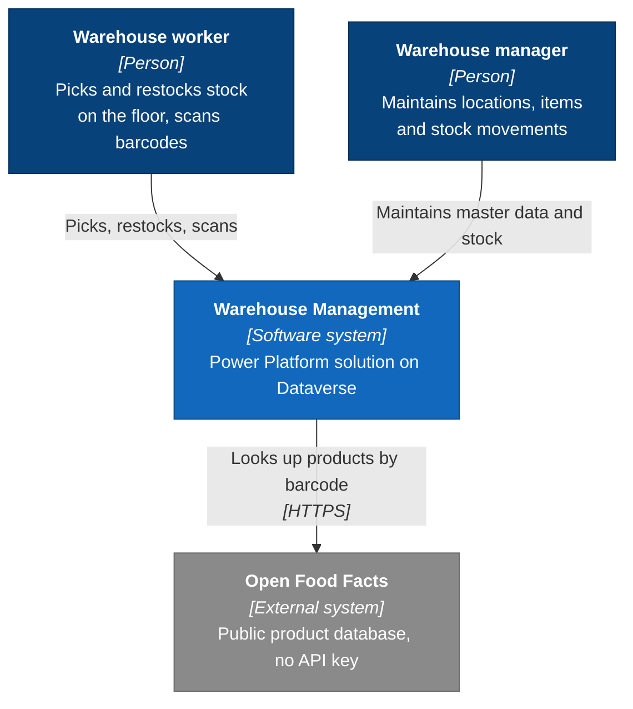
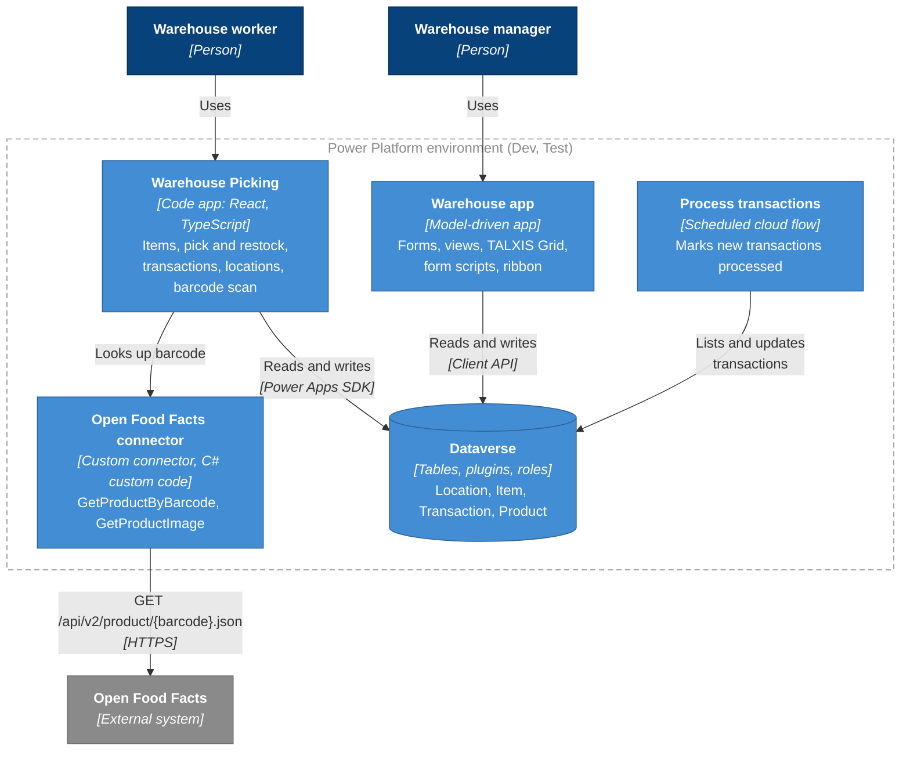
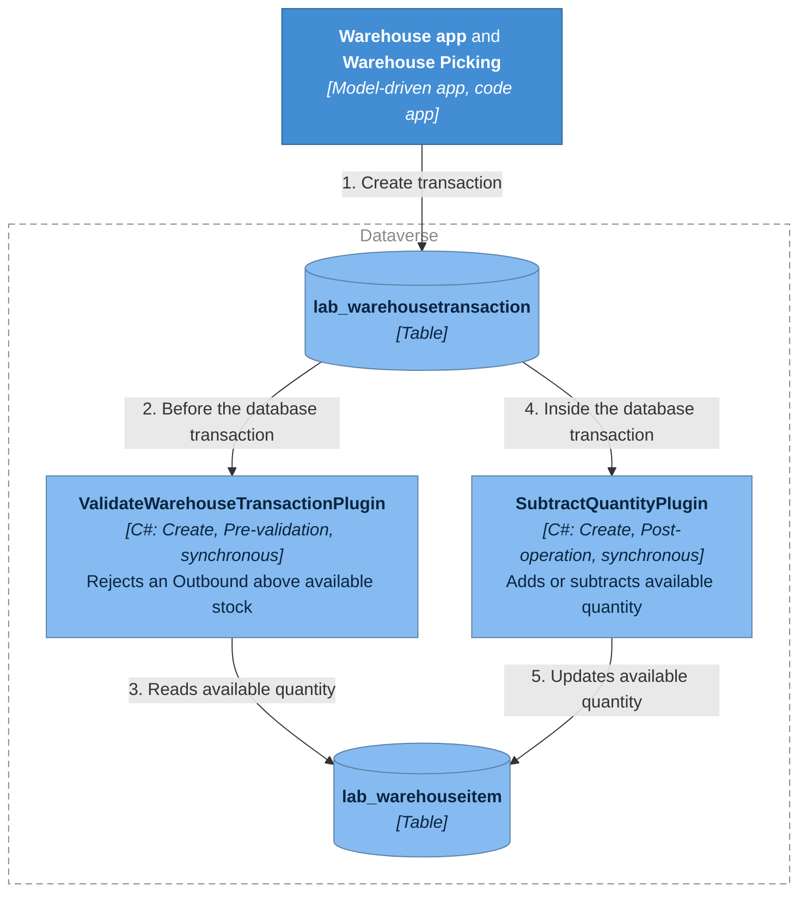
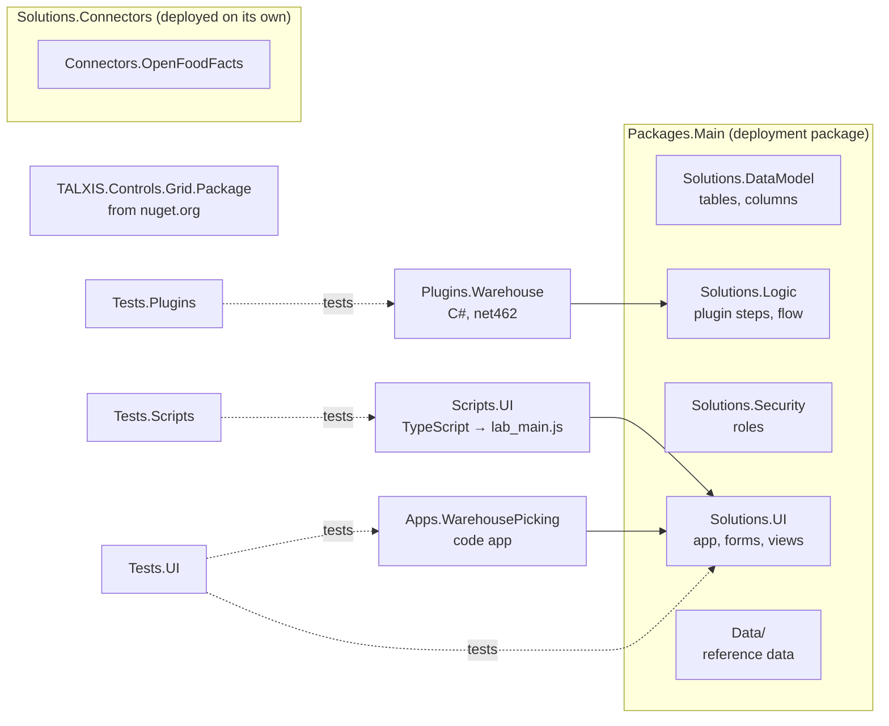

# Warehouse Management: Solution Architecture

## Purpose

Warehouse Management lets a warehouse track where its stock is, how much is on hand, and every movement in and out. It serves two kinds of users:

- **Warehouse managers** maintain locations, items and stock movements from the office.
- **Warehouse workers** pick and restock items on the floor, and identify products by scanning their barcodes.

The system runs on Microsoft Power Platform, with Dataverse as its data store. It is developed entirely as source code in one repository and deployed as packages, so every environment is built the same way.

## Design principles

1. **The server enforces the rules.** Stock rules run in Dataverse on every save, whichever app, script, flow or import makes it. User interfaces may help the user, but never decide whether an operation is allowed.
2. **One owner per concern.** The data model, business logic, security and user interface each live in their own solution. Schema changes never hide inside a UI change.
3. **Everything is source.** Tables, roles, forms, apps, connectors, flows and reference data are files under version control, reviewed in pull requests.
4. **Least privilege.** Each role gets only what its users need, at the narrowest depth that works.
5. **Credentials never ship.** Solutions carry connection references; each environment supplies its own connections.

## Specifications

| Specification | Covers |
|---|---|
| [1 · Data model and security](lab-1-data-model-and-security.md) | Tables, columns, relationships, security roles, reference data |
| [2 · Server-side business logic](lab-2-server-side-business-logic.md) | Stock validation and stock movement rules |
| [3 · User interface](lab-3-user-interface.md) | Back-office model-driven app and the floor worker's picking app |
| [4 · External data and background processing](lab-4-external-data-and-background-processing.md) | Product lookup by barcode, transaction processing job |
| [5 · Testing](lab-5-testing.md) | Unit tests, browser scenarios, quality gates |

## Conventions

| Item | Value |
|---|---|
| Publisher | `TALXISLab` |
| Customization prefix | `lab` (every schema name starts `lab_`) |
| Repository solution file | `WarehouseManagement.slnx` at the repository root |
| Source folder | `src/`, one project per folder |
| Build | `dotnet build WarehouseManagement.slnx` |
| Tooling | TALXIS DevKit (`txc` CLI and component templates), Power Apps CLI (`pa`) |
| Choice values | Start at `100000000` and increase by 1, in the order listed |

"Required" means Dataverse **business required**. Forms enforce it; the Web API and data imports do not.

## C4 level 1: System context

Diagrams follow C4 notation: dark blue for people, blue for this system and its containers, light blue for components, grey for external systems. Dashed boxes are boundaries.

## C4 level 2: Containers

## C4 level 3: Server-side logic in Dataverse

## Source layout and packaging

| Project | Kind | Specified in | Belongs to |
|---|---|---|---|
| `Packages.Main` | Package Deployer package (`.pdpkg.zip`) | 1 | Deploys everything below except connectors |
| `Solutions.DataModel` | Solution | 1 | Owns every table definition |
| `Solutions.Security` | Solution | 1 | Security roles |
| `Plugins.Warehouse` | Plugin assembly (.NET Framework 4.6.2) | 2 | Referenced by `Solutions.Logic` |
| `Solutions.Logic` | Solution | 2, 4 | Plugin assembly and steps; the cloud flow |
| `Solutions.UI` | Solution | 3 | References the tables; app, forms, views, ribbon |
| `Scripts.UI` | Script library → web resource `lab_main.js` | 3 | Referenced by `Solutions.UI` |
| `Apps.WarehousePicking` | Power Apps code app | 3 | Referenced by `Solutions.UI` |
| `Connectors.OpenFoodFacts` | Custom connector | 4 | Referenced by `Solutions.Connectors` |
| `Solutions.Connectors` | Solution | 4 | Deployed separately, before the code app uses it |
| `Tests.Plugins`, `Tests.Scripts`, `Tests.UI` | Test projects | 5 | Not deployed |

`Packages.Main` references `Solutions.DataModel`, `Solutions.Security`, `Solutions.Logic` and `Solutions.UI`, and bundles them into one deployment artifact.

## Environments and deployment

| Environment | Purpose |
|---|---|
| Dev | One per developer. Built from source; changes made by hand are pulled back into source |
| Test | Receives only built packages, through the deployment pipeline. Never edited by hand |

Deployment order for an environment:

| Step | Command | Why this order |
|---|---|---|
| 1 | `txc env pkg import TALXIS.Controls.Grid.Package` | The Location form uses the Grid control |
| 2 | `dotnet publish src/Packages.Main/Packages.Main.csproj -c Release`, then `txc env pkg import <the .pdpkg.zip under src/Packages.Main/bin/Release>` | One artifact: data model, logic, security, UI |
| 3 | `txc data pkg import src/Packages.Main/Data --allow-production` | Reference data. Plugins are disabled during import |
| 4 | Build `src/Solutions.Connectors` (Release), then `txc env pkg import Solutions.Connectors.zip` | Must exist before the code app binds to it |

Add `--profile <environment profile>` to each `txc` command when more than one environment is configured.

## Quality gates

| Gate | What it checks | Where |
|---|---|---|
| Build | `dotnet build WarehouseManagement.slnx` | `build.yml` on pull requests and pushes to `main` (also publishes the `.pdpkg.zip`) |
| Unit tests | Plugin tests (FakeXrmEasy), script tests (Jest) | `unit-tests.yml` on pull requests and pushes to `main` |
| Browser scenarios | Reqnroll and Playwright against Dev | `test.yml`, run on demand |
| Deploy to Test | Grid package, then the main package | `deploy.yml`, after a green build on `main` |

## Responsibilities by area

| Area | Owner of the decision | Verified by |
|---|---|---|
| Data model | Solution architect | Data dictionary review |
| Security | Solution architect | Privilege matrix review |
| Business rules | Product owner | Plugin unit tests, browser scenarios |
| User interface | Product owner and designer | User stories and browser scenarios |
| Integrations | Solution architect | Connector tests, browser scenario |
