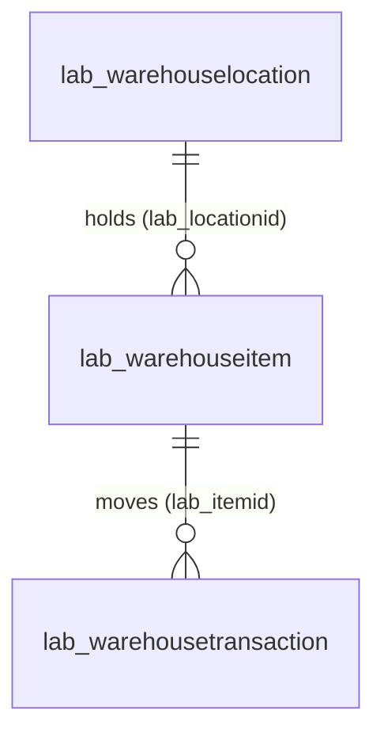

# Lab 1: Data Model

See [00-solution-architecture.md](00-solution-architecture.md) for conventions.

## Scope

This specification defines the warehouse data model and the reference data every environment starts with. Specifications 2 to 5 depend on the exact schema names, types and choice values below.

## Deliverables

| Project | Kind | Relationships |
|---|---|---|
| `src/Packages.Main` | Package Deployer package | Included in `WarehouseManagement.slnx` |
| `src/Solutions.DataModel` | Solution (publisher `TALXISLab`, prefix `lab`) | Referenced by `Packages.Main` |
| `src/Packages.Main/Data/` | Configuration Migration (CMT) package | `data_schema.xml`, `data.xml`, `[Content_Types].xml` |

## Data dictionary

All tables are **Standard** (user or team owned) tables in `Solutions.DataModel`. Each has the standard primary name column `lab_name`.

### Warehouse Location (`lab_warehouselocation`)

A physical place where items are stored. Plural display name **Warehouse Locations**, logical plural `warehouselocations`.

| Display name | Schema name | Type | Required | Details |
|---|---|---|---|---|
| Name | `lab_name` | Text | Platform default | Primary name column |
| Capacity | `lab_capacity` | Whole number | No | |
| Address | `lab_address` | Text | No | |
| Is Active | `lab_isactive` | Yes/No | No | True label **Active**, false label **Inactive** |
| Notes | `lab_notes` | Multiline text | No | |

### Warehouse Item (`lab_warehouseitem`)

A stock-keeping unit held at a location. Plural display name **Warehouse Items**, logical plural `warehouseitems`.

| Display name | Schema name | Type | Required | Details |
|---|---|---|---|---|
| Name | `lab_name` | Text | Platform default | Primary name column |
| Available Quantity | `lab_availablequantity` | Whole number | **Yes** | Maintained by the stock rule (specification 2) |
| SKU | `lab_sku` | Text | **Yes** | |
| Location | `lab_locationid` | Lookup → `lab_warehouselocation` | No | |
| Description | `lab_description` | Multiline text | No | |
| Unit Price | `lab_unitprice` | Currency | No | Precision 2 |
| Weight (kg) | `lab_weight` | Decimal | No | Precision 3 |
| Category | `lab_category` | Choice (local) | No | See choice values |
| Is Perishable | `lab_isperishable` | Yes/No | No | True **Yes**, false **No** |
| Expiration Date | `lab_expirationdate` | Date only | No | |
| Barcode | `lab_barcode` | Text | No | |
| Reorder Point | `lab_reorderpoint` | Whole number | No | Stock at or below this level is low |

Specification 5 adds one more column to this table (`lab_productid`).

### Warehouse Transaction (`lab_warehousetransaction`)

One stock movement: a pick (**Outbound**) or a restock (**Inbound**). Plural display name **Warehouse Transactions**, logical plural `warehousetransactions`.

| Display name | Schema name | Type | Required | Details |
|---|---|---|---|---|
| Name | `lab_name` | Text | Platform default | Primary name column |
| Item | `lab_itemid` | Lookup → `lab_warehouseitem` | **Yes** | |
| Quantity | `lab_quantity` | Whole number | **Yes** | |
| Transaction Type | `lab_transactiontype` | Choice (local) | **Yes** | See choice values |
| Transaction Date | `lab_transactiondate` | Date and time | **Yes** | |
| Notes | `lab_notes` | Multiline text | No | |
| Total Value | `lab_totalvalue` | Currency | No | Precision 2. Quantity × the item's unit price |
| Is Processed | `lab_isprocessed` | Yes/No | No | True **Yes**, false **No**. Set by the processing job (specification 5) |
| Processed By | `lab_processedby` | Text | No | Set by the processing job |
| Reference Number | `lab_referencenumber` | Text | No | For example a purchase or sales order number |

Where no length, format or precision is listed, the platform default applies.

### Choice values

| Column | Label | Value |
|---|---|---|
| `lab_category` | Electronics | `100000000` |
| | Clothing | `100000001` |
| | Food | `100000002` |
| | Hardware | `100000003` |
| | Other | `100000004` |
| `lab_transactiontype` | Inbound | `100000000` |
| | Outbound | `100000001` |

### Relationships

| Relationship | Implemented by | Meaning |
|---|---|---|
| Location 1 : N Item | Lookup `lab_warehouseitem.lab_locationid` | A location holds many items |
| Item 1 : N Transaction | Lookup `lab_warehousetransaction.lab_itemid` | An item has many stock movements |

No alternate keys, business rules or other relationships are defined.

## Reference data

Every environment starts with the same reference data, held as a CMT package in `src/Packages.Main/Data/`:

- `data_schema.xml` lists the tables and fields below. Each entity sets `disableplugins="true"`, so importing data never triggers the stock rules.
- `data.xml` holds the records with fixed GUIDs, so importing again updates records instead of duplicating them.
- `[Content_Types].xml` is the package manifest.

Fields included: Location `lab_name`, `lab_address`, `lab_capacity`, `lab_isactive`. Item `lab_name`, `lab_sku`, `lab_availablequantity`, `lab_category`, `lab_isperishable`, `lab_unitprice`, `lab_reorderpoint`, `lab_locationid`. Transaction `lab_name`, `lab_itemid`, `lab_quantity`, `lab_transactiontype`, `lab_referencenumber`.

**Locations**

| GUID | Name | Address | Capacity | Is Active |
|---|---|---|---|---|
| `2592a040-83b7-464e-ac3e-faff2031398c` | Main Warehouse | 123 Industrial Blvd | 1000 | True |
| `f9c0881c-258f-42eb-b58b-84f2d37cda0e` | Overflow Storage | 456 Backup Lane | 500 | True |

**Items**

| GUID | Name | SKU | Available | Category | Perishable | Unit price | Reorder point | Location |
|---|---|---|---|---|---|---|---|---|
| `6e0bd72a-0e3b-487c-b143-4c694e9e488a` | Office Laptop | LTP-001 | 100 | 100000000 | False | 899.00 | 20 | Main Warehouse |
| `b9201d73-02eb-4065-bf4d-b5f5c5bd4b70` | Wireless Mouse | MSE-002 | 5 | 100000000 | False | 19.99 | 10 | Main Warehouse |
| `e42c5c02-0cd1-4fe5-b6ef-c2c620f1bfcf` | Laser Printer | PRN-003 | 50 | 100000000 | False | 249.50 | 15 | Overflow Storage |
| `0552ebd4-dbf7-47ed-bf92-fae96f36fe7c` | Nutella Hazelnut Spread 400g | FOD-004 | 200 | 100000002 | True | 4.99 | 40 | Main Warehouse |
| `cbe58fd5-4622-418d-ac8b-04d8041c8c65` | Coca-Cola 330ml Can (24-pack) | FOD-005 | 150 | 100000002 | True | 12.99 | 30 | Main Warehouse |

**Transactions** (historical records; they don't change stock on import)

| GUID | Name | Item | Quantity | Type | Reference |
|---|---|---|---|---|---|
| `a0cdb965-1279-4f0a-a5db-58f335b9863e` | TRX-0001 | Office Laptop | 20 | 100000000 (Inbound) | PO-2026-001 |
| `cc2d0547-3872-4f50-8db9-0cbb5407e535` | TRX-0002 | Wireless Mouse | 5 | 100000001 (Outbound) | SO-2026-014 |

Specification 5 extends this package with products.

## Acceptance criteria

- [ ] `dotnet build WarehouseManagement.slnx` succeeds.
- [ ] Every table, column, type, required level and choice value matches the data dictionary.
- [ ] Both relationships exist, and `lab_itemid` is business required.
- [ ] The reference data package contains the 9 records above with their GUIDs.
- [ ] `Packages.Main` references `Solutions.DataModel`.

## Design rationale

- **One solution per concern.** `Solutions.DataModel` owns every table; other solutions only reference them, so schema changes are always reviewed on their own.
- **Schema as source.** Every table is a reviewable file and is rebuilt identically in every environment.
- **Reference data as source.** Fixed GUIDs make the same package safe to import into any environment, any number of times.
