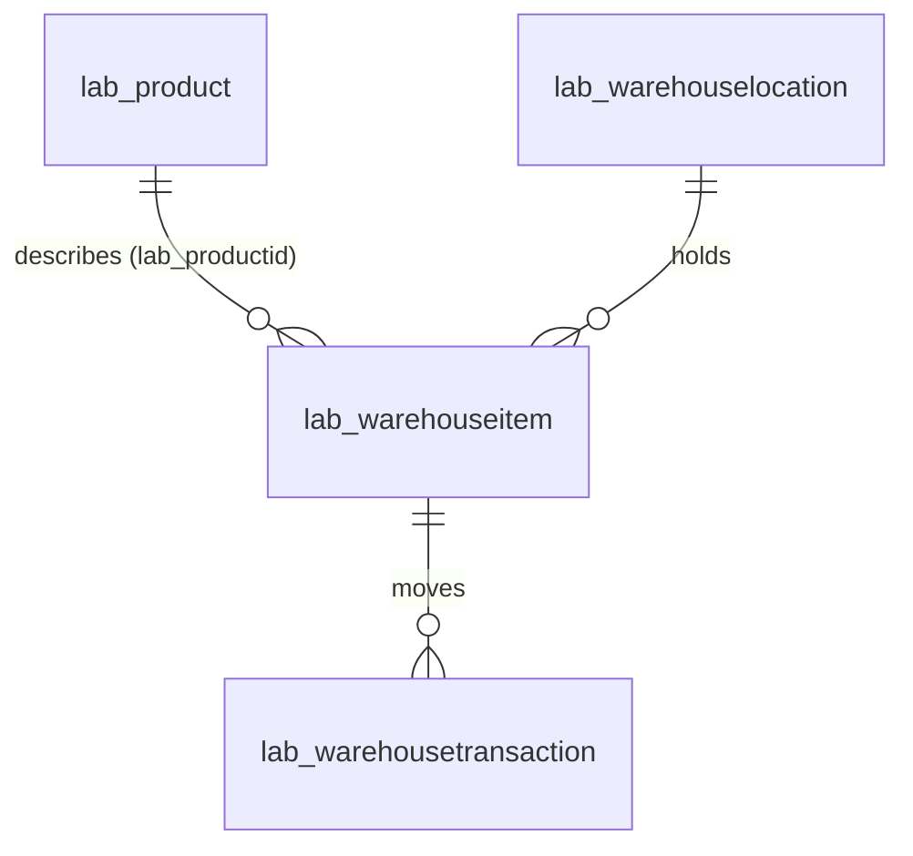

# Lab 5: External Data and Background Processing

Depends on specifications 1 to 4.

## Scope

1. **External product data.** A worker scans or types a product barcode on an item. The system looks the product up in the public Open Food Facts database through a custom connector, saves it to Dataverse and links it to the item.
2. **Background processing.** A scheduled job processes new transactions outside the user's save, so no user waits for it and its failures never affect a pick.

## Part A: Product data model

### Product (`lab_product`)

Catalog data for a barcode, kept separate from Warehouse Item, which models this warehouse's own stock. Added to `Solutions.DataModel` as a Standard table. Display name **Product**, plural **Products**, logical plural `products`. The primary name column `lab_name` holds the product's name.

| Display name | Schema name | Type | Required | Details |
|---|---|---|---|---|
| Name | `lab_name` | Text | Platform default | Primary name column |
| EAN | `lab_ean` | Text | **Yes** | The barcode |
| Brand | `lab_brand` | Text | No | |
| Quantity | `lab_quantity` | Text | No | Free text from the source, such as `400 g` or `330 ml`. Not a number |
| Image URL | `lab_imageurl` | Text | No | **Max length 500** |
| Last Synced On | `lab_lastsyncedon` | Date and time | No | |
| Product Image | `lab_productimage` | **File** | No | A File column, so the code app can upload to it |

### New column on Warehouse Item

| Display name | Schema name | Type | Required |
|---|---|---|---|
| Product | `lab_productid` | Lookup → `lab_product` | No |

There is no alternate key on EAN; products are found by filtering on `lab_ean`.

### Security

Neither security role is granted privileges on `lab_product`.

### Reference data

The reference data package from specification 1 is extended:

- `data_schema.xml` gains a `lab_product` entity (`disableplugins="true"`) with `lab_name`, `lab_ean`, `lab_brand`, `lab_quantity`, `lab_imageurl` and `lab_lastsyncedon`, placed **before** `lab_warehouseitem` so products import first. The item entity gains `lab_productid` (lookup to `lab_product`).
- `data.xml` gains these products, and the two food items are linked to them.

| GUID | Name | EAN | Brand | Quantity | Image URL | Last Synced On |
|---|---|---|---|---|---|---|
| `611e6410-7c90-4c63-abf7-825af79eb636` | Nutella | 3017620422003 | Nutella, Ferrero | 400 g e | `https://images.openfoodfacts.org/images/products/301/762/042/2003/front_en.879.400.jpg` | 2026-01-15T00:00:00Z |
| `ff3dfa41-6780-44bb-8dfe-a6a48a5d10f9` | Coca-Cola | 5449000000996 | COCA-COLA SERVICES SA/NV, Coca-Cola | 330 ml | `https://images.openfoodfacts.org/images/products/544/900/000/0996/front_en.1129.400.jpg` | 2026-01-15T00:00:00Z |

| Item | Linked product |
|---|---|
| Nutella Hazelnut Spread 400g (`0552ebd4-dbf7-47ed-bf92-fae96f36fe7c`) | Nutella |
| Coca-Cola 330ml Can (24-pack) (`cbe58fd5-4622-418d-ac8b-04d8041c8c65`) | Coca-Cola |

## Part B: Open Food Facts custom connector

| Item | Value |
|---|---|
| Connector project | `src/Connectors.OpenFoodFacts`. Host `world.openfoodfacts.org`, display name **Open Food Facts**, description *Look up product data by barcode from the Open Food Facts public database.*, no authentication, custom code enabled |
| Solution | `src/Solutions.Connectors` (publisher `TALXISLab`, prefix `lab`, no plugin assembly), referencing the connector project |
| Packaging | Not part of `Packages.Main`. Deployed on its own, before the code app uses it |
| Connector schema name | `lab_connectorsopenfoodfacts` |

### API definition

OpenAPI 2.0, scheme `https`, base path `/api/v2`.

| Operation id | Request | Response |
|---|---|---|
| `GetProductByBarcode` | `GET /product/{barcode}.json`, `barcode` in path, required, string | `200` with a `Product`: `ean`, `name`, `brand`, `quantity`, `imageUrl` (all strings) |
| `GetProductImage` | `GET /product-image?imageUrl=...`, `imageUrl` in query, required, string | `200` with the image bytes (`type: file`; produces `image/jpeg`, `image/png`; `x-ms-media-kind: image`) |

### Custom code

A `Script : ScriptBase` class that routes on `Context.OperationId`:

| Operation | Behaviour |
|---|---|
| `GetProductByBarcode` | Adds the header `User-Agent: TALXIS-Lab-WarehousePicking/1.0 (+https://github.com/TALXIS/lab)`, which Open Food Facts requires, and sends the request. A non-success response passes through. If the body's `status` isn't `1`, returns **404** with `{"message": "No product found for this barcode"}`. Otherwise returns the flattened product: `ean` ← `code`, `name` ← `product.product_name`, `brand` ← `product.brands`, `quantity` ← `product.quantity`, `imageUrl` ← `product.image_url` |
| `GetProductImage` | If `imageUrl` is missing, returns **400** with `{"message": "imageUrl query parameter is required"}`. Otherwise sends the request to `imageUrl` with the same `User-Agent` and returns the bytes, so the code app can display images its content security policy would otherwise block |

## Part C: Code app integration

| Item | Value |
|---|---|
| Product data source | `lab_product`, as a generated typed service (`Lab_productsService`) |
| Item data source | Regenerated so its model includes `lab_productid` |
| Connector data source | Named `OpenFoodFacts`, operations `GetProductByBarcode(barcode)` and `GetProductImage(imageUrl)`, exposed as a typed `OpenFoodFactsService` |
| Connection | Created per environment: `pa connection create --connector lab_connectorsopenfoodfacts --display-name "Open Food Facts" --json`, then bound with `pa app add data-source --connector lab_connectorsopenfoodfacts --connection-id <id>` |
| Camera decoding | `@zxing/browser` |

## Part D: Barcode scan

### User story US-13: Identify a product by its barcode

**As a** warehouse worker, **I want** to scan a product's barcode on an item and link the product details to it, **so that** everyone sees exactly what the item is, with its picture.

| # | Given | When | Then |
|---|---|---|---|
| 1 | I'm on an item's detail | I select **Scan Barcode** (**Rescan Barcode** if it already has a product) | A dialog opens with a camera view and a field to type the barcode |
| 2 | The dialog is open | I scan a barcode, or type `3017620422003` and select **Look Up** | A preview shows the product name **Nutella** and its image |
| 3 | The dialog is open | I look up a barcode that doesn't exist | I see **No product found for this barcode** |
| 4 | The preview shows Nutella | I select **Link to Item** | The item's detail shows **Nutella** as its linked product, with its image |
| 5 | A Product with that EAN already exists | I link it | The existing Product is reused; no duplicate is created |
| 6 | Saving the image fails | I link the product | The product is still linked, and I'm told the image failed to save |

### Linking behaviour

Selecting **Link to Item**:

1. finds a Product whose `lab_ean` equals the barcode, or creates one with `lab_name` (the product name, or the EAN if it has none), `lab_ean`, `lab_brand`, `lab_quantity`, `lab_imageurl` and `lab_lastsyncedon` (now);
2. sets the item's `lab_productid` to that Product;
3. uploads the image bytes to the Product's `lab_productimage` column.

These are three separate operations with no rollback between them. If step 3 fails, steps 1 and 2 stand.

A camera scan and a typed barcode follow the same path. The typed path must always be available, because devices without a camera depend on it.

The dialog's visual design is open.

## Part E: Background processing

### Process transactions job

| Item | Value |
|---|---|
| Flow | **Process transactions**, logical name `lab_processtransactions`, a solution-aware cloud flow in `src/Solutions.Logic/Workflows` |
| Trigger | Recurrence, every 15 minutes. Can also be run on demand |
| Step 1 | Dataverse **List rows** (`ListRecords`) on `lab_warehousetransactions`, filter `lab_isprocessed ne true` |
| Step 2 | For each row, Dataverse **Update a row**: `lab_isprocessed` = Yes, `lab_processedby` = `Process transactions` |
| Connection | A Dataverse (`shared_commondataserviceforapps`) connection reference, bound to a connection in each environment |
| Runs as | The connection reference's owner. That account needs Read and Write on transactions |

Because the stock rules are registered on Create only, this update never changes stock.

The flow definition must validate against the environment's connector metadata (`txc environment flow validate src/Solutions.Logic/Workflows --connection-check`). Operation ids and parameter names come from that metadata, not from memory.

## Acceptance criteria

| # | Given | When | Then |
|---|---|---|---|
| 1 | The connector is deployed | `GetProductByBarcode` is called with `3017620422003` | It returns `name` **Nutella** and an `imageUrl` |
| 2 | The connector is deployed | It's called with a barcode that doesn't exist | It returns 404 |
| 3 | US-13 | All six criteria are exercised in Dev | All pass |
| 4 | A transaction exists with Is Processed not Yes | **Process transactions** runs | That transaction has Is Processed = Yes and Processed By = `Process transactions`, and the item's stock is unchanged |

- [ ] `dotnet build WarehouseManagement.slnx` succeeds, and `src/Solutions.Connectors` builds.
- [ ] The Product table and the item lookup match Part A exactly.
- [ ] The reference data imports with both products and both links.
- [ ] The flow definition validates against the environment.
- [ ] All four criteria pass in Dev, verified with a System Administrator account.

## Design rationale

- **Credentials never ship.** The connector needs no key, and the solution carries references; each environment supplies its own connection.
- **The connector shapes the data.** The required header and the response flattening live in one place, not in every app that calls it.
- **Separate operations, stated plainly.** Linking a product is three calls without rollback. That is acceptable here because each step leaves valid data; an all-or-nothing need would call for a single server-side operation.
- **Synchronous where it matters.** The stock rule runs during the save because it enforces a rule. Bookkeeping such as "processed" runs later, outside the user's transaction.
